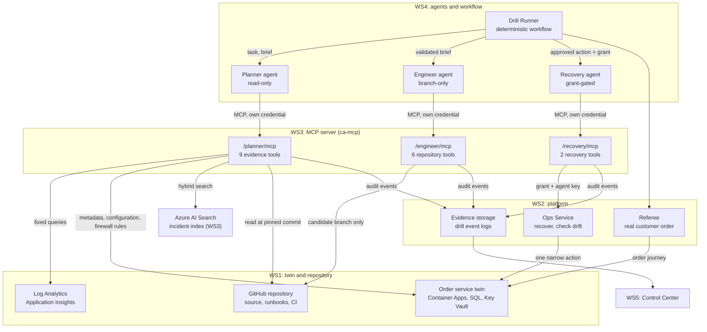
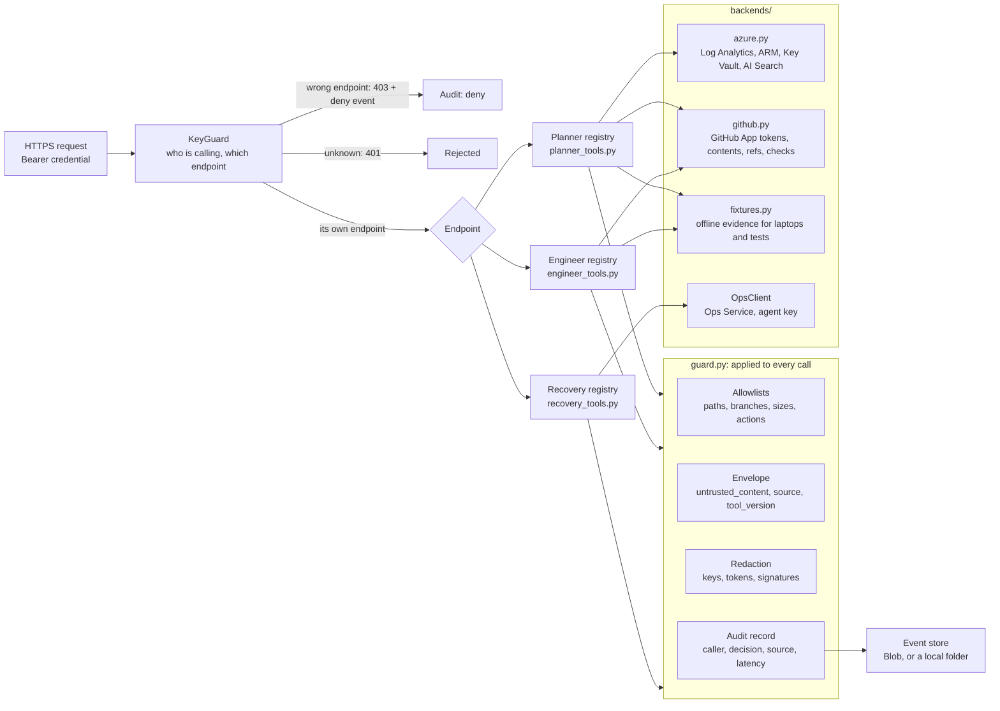
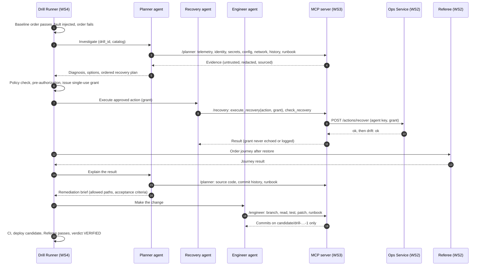
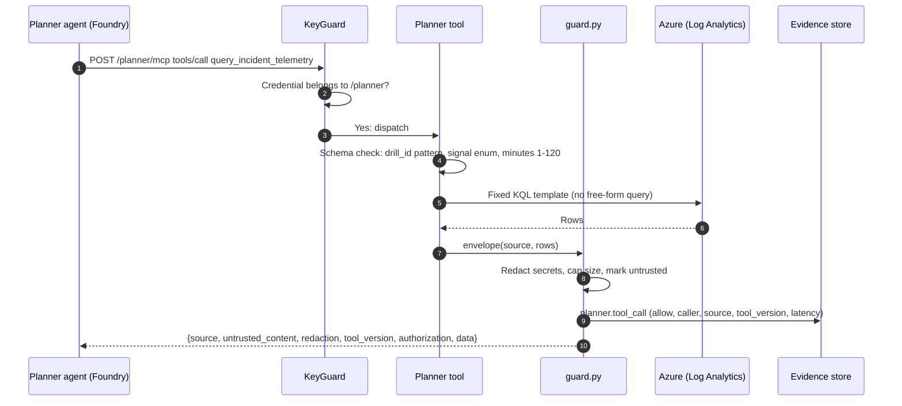
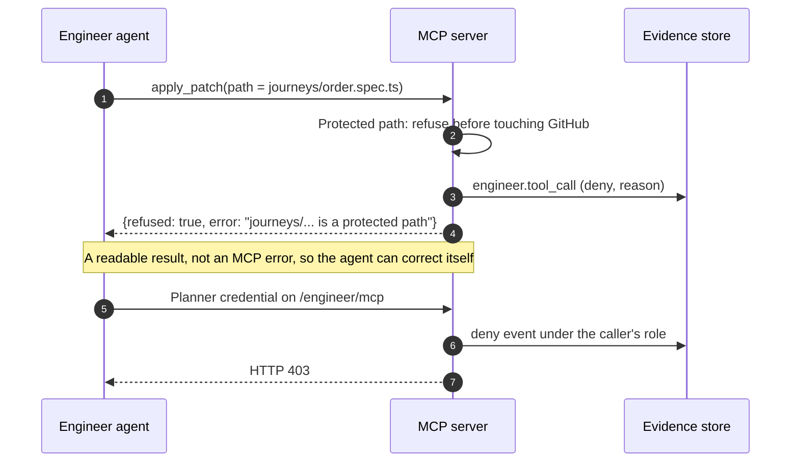
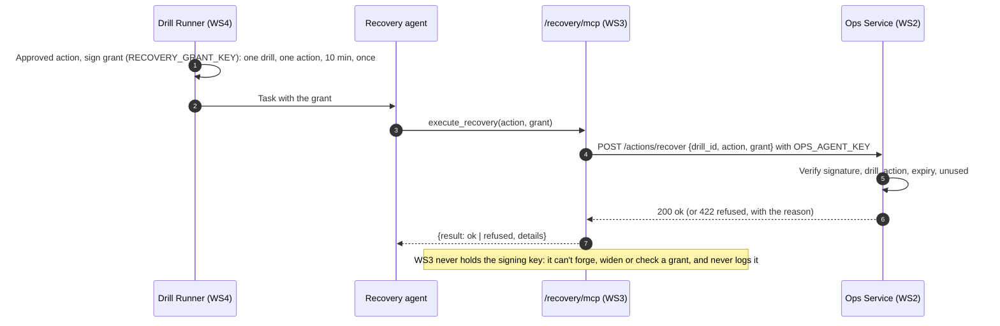
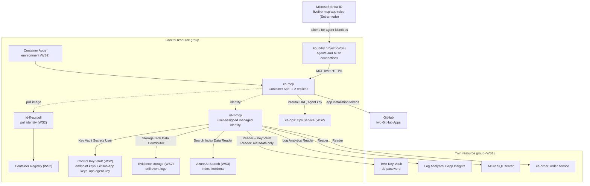
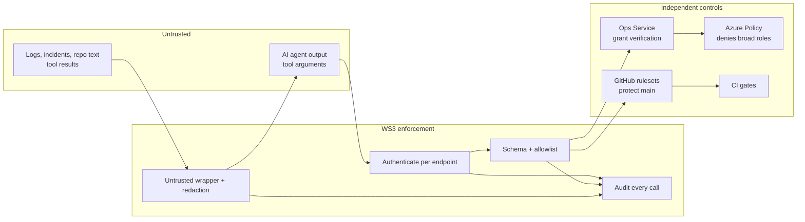

# WS3 architecture: the MCP server in LiveFire Fusion

**Component:** LiveFire MCP server (`ca-mcp`) · **Workstream:** WS3 · **Contract:** v2.3 · **Status:** running in Azure,
used by real Foundry agents in every Autonomous drill scenario (Nov 1–2, 2026)

## 1. What this component is, in one paragraph

LiveFire Fusion rehearses a cyber-recovery on a disposable Azure twin of an order service. A fault is injected, AI
agents investigate and recover it, an independent Referee checks that customers can really order again, and an
agent proposes a code change on a candidate branch. **WS3 is
the only door between those AI agents and the outside world.** The agents hold no Azure credentials, no GitHub
tokens and no shell. Every piece of evidence they read and every change they make goes through one of the MCP
server's three endpoints. Each endpoint authenticates its own agent, allows only its own tools, checks every argument
against a server-side allowlist, wraps every result as untrusted data, redacts secrets, and writes an audit record.
That is what makes the agents' autonomy safe to demonstrate: they can reason freely, but they can only *act* through
a narrow, typed, audited interface.

## 2. Where WS3 sits in the ecosystem

| Workstream | Owns | Relationship to WS3 |
| --- | --- | --- |
| WS1 | The order service, its disposable Azure twin (Container Apps, SQL, Key Vault, telemetry), the repository | WS3 **reads** the twin's evidence and the repo; the Engineer writes only candidate branches |
| WS2 | The platform (Container Apps environment, registry, Key Vault, evidence storage), the Ops Service, the Referee, Azure Policy | WS3 **runs on** the platform; the Recovery tools **call** the Ops Service |
| **WS3** | **The MCP server, the incident corpus and index, the GitHub controls** | The agents' governed tool interface |
| WS4 | The Foundry agents (Planner, Engineer, Recovery) and the Drill Runner workflow | The agents **call** WS3; the Drill Runner issues the grants the Recovery agent passes on |
| WS5 | The Fusion Control Center | **Reads** WS3's audit events to show every tool call live |

What WS3 deliberately does **not** do: inject faults, deploy, run the Referee, approve anything, or decide the
verdict. Those are deterministic operations in the Drill Runner and the Ops Service, outside the agents' reach.

## 3. Inside the component

One container serves three isolated MCP servers. Each has its own tool registry; a credential for one endpoint is
refused on the others. Everything a tool returns or records passes through one shared guard.

| Module | Responsibility |
| --- | --- |
| `main.py` | Starts the three MCP servers, the `KeyGuard` (authentication per endpoint), host checks and `/health` |
| `entra_auth.py` | Entra mode: validates a token's signature, audience, issuer, `oid` and app role for each endpoint |
| `planner_tools.py` | The nine read-only evidence tools, and the paths the Planner may read |
| `engineer_tools.py` | The six branch-only tools, the write allowlist and patch-size limits |
| `recovery_tools.py` | The two recovery tools and the Ops Service client; forwards the grant, never records it |
| `guard.py` | Allowlists, protected paths, the result envelope, redaction, refusals as results, the audit record |
| `livefire_events.py` | The drill event log (`blob:` in Azure, `dir:` locally), shared with the other workstreams |
| `backends/` | Where data comes from: Azure, GitHub, or fixtures for offline runs |

## 4. How it is used during a drill

The drill's agents reach WS3 at four moments. This is the Autonomous Twin flow.

### One evidence call, in detail

### A refused call

### The recovery grant

## 5. Azure deployment

The container has **no secret in its configuration**: the endpoint keys, the GitHub App private keys and the Ops key
are Key Vault references resolved by Container Apps with the managed identity. Its Azure reads use the same identity.
The deployer also gets Search roles, to load the index after each rebuild.

## 6. Azure services WS3 uses, and why

| Service | What WS3 uses it for | Why it's needed |
| --- | --- | --- |
| **Azure Container Apps** | Hosts `ca-mcp` (0.5 vCPU, 1 GiB, 1–2 replicas, HTTPS ingress) in the platform's environment | Managed HTTPS endpoint with managed identity and Key Vault references, so no secret is baked in; the same environment as the Ops Service, which the recovery tools reach on its internal URL |
| **Managed identity** (`id-lf-mcp`) | Every Azure call the server makes, and resolving its secrets | No credentials in code or configuration; least-privilege roles scoped to exactly the resources the tools read |
| **Azure Container Registry** | Stores the `mcp-server:sha-<commit>` image, pulled by a pull-only identity | Private, immutable, scanned images; CI pushes through OIDC, so GitHub stores no Azure secret |
| **Azure Key Vault** (control) | Endpoint keys, GitHub App private keys, `ops-agent-key` | Credentials never leave Key Vault or reach the agents; rotation is a Key Vault change |
| **Azure Key Vault** (twin) | `get_secret_metadata`: versions and timestamps of `db-password`, never the value (Key Vault Reader) | Shows *when* a secret changed, without ever showing a secret |
| **Azure Monitor: Log Analytics and Application Insights** | `query_incident_telemetry`: fixed KQL templates over requests, exceptions, dependencies, metrics and SQL errors | The Planner needs real telemetry, tied to the drill ID; fixed queries stop free-form or exfiltrating queries |
| **Azure Resource Manager** | `get_identity_snapshot` (role assignments on the twin vault), `get_app_configuration` (revisions and non-secret settings), `get_network_rules` (SQL firewall) | Current resource state for the Planner to compare; read-only roles on exactly those resources |
| **Azure AI Search** | The `incidents` index: curated incidents and runbooks, keyword and hybrid (vector) retrieval, filtered to the order service and optionally a date range | Grounds the Planner in prior incidents with provenance and a retrieval score, from a bounded corpus rather than the open web |
| **Azure OpenAI embeddings (via Foundry, WS4)** | The search index's vectorizer embeds queries for hybrid retrieval | Matches by meaning that keyword search misses |
| **Azure Blob Storage** (evidence) | Appends one `*.tool_call` event per call to `<drill_id>/events.jsonl` | One shared, append-only drill log that the Control Center, the evidence package and the scorecard all read |
| **Microsoft Entra ID** | Entra mode: the `livefire-mcp` app registration, the app roles `MCP.Planner`, `MCP.Engineer`, `MCP.Recovery`, each assigned to one agent identity | Each agent authenticates as itself, with no shared key; a person's own token is refused |
| **Microsoft Foundry (WS4)** | The caller: each agent has one MCP tool pointed at its endpoint, through a project connection | Agents reach tools only through MCP; the connection holds the credential, never the agent |
| **OpenTelemetry → Application Insights** | A span per tool call (endpoint, tool, decision, version) | Tool calls appear in the same trace as the model calls, for the demo and for diagnosis |

## 7. The tools, and why each exists

### Planner: read-only evidence (`/planner/mcp`)

| Tool | Reads | Why the Planner needs it |
| --- | --- | --- |
| `query_incident_telemetry` | Log Analytics (fixed queries; `sql_errors` groups failed orders by SQL error number) | Shows *that* customers fail and with which errors |
| `get_identity_snapshot` | Role assignments on the twin vault | The identity's current access to the vault |
| `get_secret_metadata` | Versions of the twin's `db-password` | When each secret version was created |
| `get_app_configuration` | The order app's revisions and their differences from the desired settings | Which settings differ from the desired state, and since which revision |
| `get_network_rules` | The SQL server's firewall rules | The current firewall rules |
| `search_incident_history` | AI Search incidents and runbooks | Prior incidents and runbooks, with provenance |
| `read_runbook` | A runbook at the pinned commit, with its checksum | What the procedure says |
| `read_repository_context` | Allowed source and docs at the pinned commit, with checksum | How the code behaves |
| `get_commit_history` | Recent commits touching an allowed path | When and why a file changed |

### Engineer: branch-only changes (`/engineer/mcp`)

| Tool | Does | Why |
| --- | --- | --- |
| `create_candidate_branch` | Creates `candidate/<drill_id>-<attempt>` from the pinned base commit | Every change is isolated, reviewable and kept as evidence; never `main` |
| `read_allowed_files` | Reads up to 5 allowed files (base or its own branch) | The minimum context to write a fix, nothing more |
| `apply_patch` | Commits the full new content of one file allowed by `ENGINEER_WRITE_PATHS` (≤ 200 lines changed) | The change itself, bounded in place and size |
| `write_regression_test` | Commits `src/order-service/tests/test_*.py` | Keeps the change covered by a test |
| `update_runbook` | Commits a runbook change | Keeps the procedure in step with the change |
| `get_ci_results` | Reads the candidate's GitHub Actions status | Lets the Engineer react to its own CI failure on attempt 2 |

### Recovery: grant-gated execution (`/recovery/mcp`)

| Tool | Does | Why |
| --- | --- | --- |
| `execute_recovery` | Asks the Ops Service to run one approved action, with its single-use grant | The agent carries out recovery itself, but only exactly what a person or policy approved |
| `check_recovery` | Asks whether the twin matches its desired state (ok or drift, never which part) | Confirms the action worked without handing the diagnosis to the wrong agent |

### Developer and operator tools in this folder

| Tool | Why it exists |
| --- | --- |
| **Python 3.12, MCP SDK, Starlette, uvicorn** | The server: MCP streamable HTTP in stateless JSON mode, so any HTTP client or Foundry can call it without a session |
| **Docker and Docker Compose** | The same image locally and in Azure; `scripts/run-local.sh` runs the server and a stand-in Ops Service with no Azure |
| **GitHub Apps** (Planner: read; Engineer: contents write, actions read) | Short-lived installation tokens per role, scoped to one repository; the agents never see them |
| **GitHub rulesets and CODEOWNERS** | `main` needs a reviewed pull request and passing checks; candidate branches can't be deleted; neither GitHub App can bypass them (only repo admins, and only through a pull request) |
| **GitHub Actions + Bandit, Semgrep, pip-audit, gitleaks, Trivy** | Free security gates on every change (no GitHub Advanced Security needed), then an OIDC push to the private registry |
| **Bicep** | `mcp.bicep` and `mcp-twin-access.bicep`: the app, identity, search service and exactly the roles above, reproducibly |
| **pytest** (68 tests) | Endpoint isolation, allowlists, redaction, the envelope, audit fields, refusals, the grant path, Entra validation, and a contract check |
| **`export-tool-schemas.py`** | Publishes every tool's schema from the code; a test fails if the published contract drifts |
| **`fake-ops.py`** | Lets anyone test the recovery path offline with the same wire contract as the real Ops Service |

## 8. Design decisions

| Decision | Reason |
| --- | --- |
| **Three endpoints, one container** | Separate registries and credentials give least privilege per agent; one deployment keeps it cheap and simple. The blueprint allows either. |
| **Agents hold no credentials** | The MCP server holds them (in Key Vault) and enforces policy server-side, so a prompt-injected agent still can't exceed its tools. |
| **Fixed queries and allowlists, not free-form access** | An agent can't widen what it reads or writes by asking cleverly. |
| **Every result marked untrusted, and redacted** | Tool output can contain hostile text (T-08). The agents treat it as data; secrets never enter model context. |
| **Refusals are results, not errors** | Foundry fails the whole agent turn on an MCP error; a readable refusal lets the agent correct itself, and it is still audited. |
| **The grant is verified downstream, not by WS3** | WS3 can't forge or widen what it can't sign; compromising WS3 doesn't grant recovery authority. |
| **Arguments hashed in the audit, never stored** | The audit proves what happened without copying payloads (or a grant) into logs. |
| **Stateless MCP over HTTP** | Any replica can serve any call; scaling and restarts lose nothing. |
| **Fixtures backend** | The full server runs offline, so tests, demos and other teams don't need Azure. |

## 9. Security boundaries at a glance

WS3 is one layer of defence, not the only one: even if WS3 were bypassed, the Ops Service still verifies every grant,
Azure Policy still denies broad roles, GitHub rulesets still protect `main`, and CI still gates every candidate.

## 10. Further reading

- [README-WS3.md](../README-WS3.md): running it and deploying it.
- [contracts/mcp-contract.md](../contracts/mcp-contract.md): how other workstreams call it.
- [contracts/mcp-tools.md](../contracts/mcp-tools.md) and [contracts/mcp-tools.schema.json](../contracts/mcp-tools.schema.json):
  the per-tool contract and schemas.
